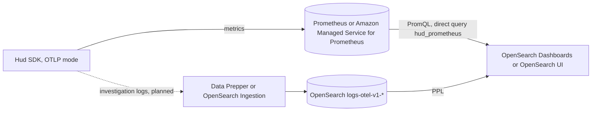

# Hud Integration

[Hud](https://hud.io) is a runtime code sensor. Its SDK reports function-level and endpoint-level telemetry (calls, durations, errors) from production services as OpenTelemetry metrics, and will record an investigation log for each failing or unusually slow request.

This integration ships three dashboards over that data: **service overview**, **endpoint** and **function**. See [info/README.md](info/README.md) for what each one shows.


## Data flow



- **Metrics** (`code_function_*`, `code_flow_duration_seconds`) go to Prometheus or Amazon Managed Service for Prometheus (AMP) as native histograms and counters, and are read through a Prometheus direct-query data source named `hud_prometheus`. The metric and label names listed in [info/README.md](info/README.md#metrics-prometheus) are the contract the dashboards depend on.
- **Investigation logs** (`attributes.event.name = 'hud.investigation'`) are not exported yet by the SDK in OTLP mode. When they are, Data Prepper or OpenSearch Ingestion indexes them into `logs-otel-v1-*`; their planned fields are described by [schemas/logs_hud-1.0.0.mapping.json](schemas/logs_hud-1.0.0.mapping.json), with examples in [data/sample.json](data/sample.json).

## Requirements

- OpenSearch Dashboards 3.10 or later, with Explore and dashboard variables (`dashboard.variables.enabled`) enabled, or an Observability workspace in OpenSearch UI on Amazon OpenSearch Service. Links between dashboards set variables to `$__all`, which is supported from 3.10 ([OpenSearch-Dashboards#12970](https://github.com/opensearch-project/OpenSearch-Dashboards/pull/12970)); on 3.9 the linked dashboards show no data.
- A Prometheus direct-query data source named `hud_prometheus`, backed by a Prometheus 2.40 or later with native histograms enabled, or by an AMP workspace.

## Setup

For Amazon OpenSearch Service with AMP, follow [info/README.md](info/README.md#amazon-opensearch-service-and-amazon-managed-service-for-prometheus) instead of step 1.

1. Create the Prometheus data source, for example with the SQL plugin's data source API:

   ```
   POST _plugins/_query/_datasources
   {
     "name": "hud_prometheus",
     "connector": "prometheus",
     "properties": { "prometheus.uri": "http://prometheus:9090" }
   }
   ```

2. Install **Hud** from **Integrations**, entering `logs-otel-v1*` as the data source. Alternatively, import `assets/hud-shared-1.0.0.ndjson` and then the dashboard bundles under **Dashboards Management > Saved objects**. The links between dashboards open dashboards by saved object id. Manual import keeps the ids, so the links work. After an install from **Integrations**, the installer rewrites the ids of the targets each panel declares as `link_*` references (for example `link_function_dashboard`), so the links work with the installer fix in [dashboards-observability#1](https://github.com/code-hud/dashboards-observability/pull/1); see [Installation](info/README.md#installation).
3. Open **Hud: service overview** and pick a service.

## Contents

| Path | Contents |
| --- | --- |
| `hud-1.0.0.json` | Integration config |
| `assets/hud-shared-1.0.0.ndjson` | `logs-otel-v1*` index pattern |
| `assets/hud-*-1.0.0.ndjson` | One saved-object bundle per dashboard |
| `schemas/logs_hud-1.0.0.mapping.json` | Mapping for Hud investigation logs |
| `data/sample.json` | Sample investigation records |
| `static/` | Logo and dashboard screenshots |
