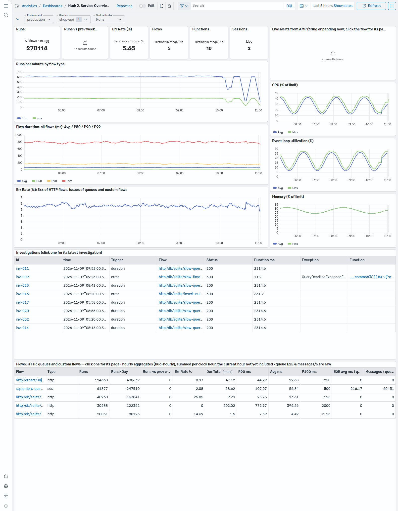
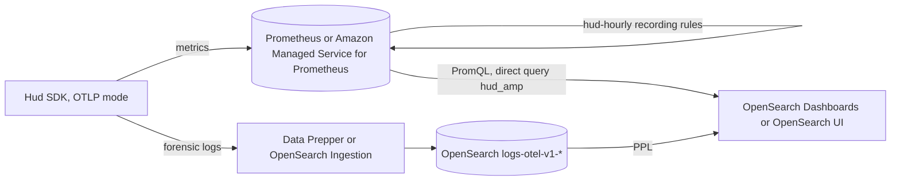

# Hud Integration

[Hud](https://hud.io) is a runtime code sensor. Its SDK reports flow-level and function-level telemetry (runs, durations, errors, sessions, process metrics) from production services as OpenTelemetry metrics, and records a forensic log (an investigation) for each failing or unusually slow request.

This integration ships five linked dashboards over that data: **Hud: 1. Services**, **Hud: 2. Service Overview**, **Hud: 3. Flow**, **Hud: 4. Function** and **Hud: 5. Investigation Details**. See [info/README.md](info/README.md) for what each one shows.



## Data flow



- **Metrics** (`code_flow_*`, `code_function_*`, `hud_flow_*`, process metrics) go to Prometheus or Amazon Managed Service for Prometheus (AMP) as native histograms, counters and gauges, and are read through a Prometheus direct-query data source named `hud_amp`. The service is the `job` label. The metric and label names listed in [info/README.md](info/README.md#metrics-prometheus) are the contract the dashboards depend on.
- **Hourly aggregates.** The tables and KPI tiles of **Hud: 1. Services** and **Hud: 2. Service Overview** read the `hud-hourly` recording rules (`job:…`, `flow:…`, `function:…`, `instance:…:increase1h`) instead of raw samples.
- **Forensic logs** (`hud.forensic` log records, recognized by `attributes.hud.forensic.type`) go through Data Prepper or OpenSearch Ingestion into `logs-otel-v1-*`, with nested OTel attributes (`attributes.*`, `resource.attributes.*`), and are read with PPL. The fields the panels use are listed in [info/README.md](info/README.md#forensic-logs-opensearch) and mapped by [schemas/logs_hud-1.0.0.mapping.json](schemas/logs_hud-1.0.0.mapping.json), with sample records in [data/sample.json](data/sample.json).

## Requirements

- Self-managed: OpenSearch Dashboards 3.9 or later, with Explore and dashboard variables (`dashboard.variables.enabled`) enabled.
- Amazon OpenSearch Service: an Observability workspace in [OpenSearch UI](https://docs.aws.amazon.com/opensearch-service/latest/developerguide/application.html), which is hosted separately from the domain. The domain's engine version (3.8 included) doesn't set the floor.
- A Prometheus direct-query data source named `hud_amp`, backed by a Prometheus 2.40 or later with native histograms enabled, or by an AMP workspace.
- **The `hud-hourly` recording rules, installed in that Prometheus with their names unchanged.** This integration can't install Prometheus rules. Install them from [hud-o11y-resources](https://github.com/code-hud/hud-o11y-resources): see [Hourly recording rules](https://github.com/code-hud/hud-o11y-resources/blob/main/deploy/README.md#hourly-recording-rules) (the rules are in [`deploy/aws/hud-hourly-rules.yaml`](https://github.com/code-hud/hud-o11y-resources/blob/main/deploy/aws/hud-hourly-rules.yaml), as an AMP rule namespace). Without them the Services and Service Overview tables and tiles are empty; with them, those panels start filling in after the rules have run for an hour.
- The SDK's forensic log records in `logs-otel-v1-*` (tested with OpenSearch 3.9). Without them the investigations and exceptions panels are empty.

Alert rules for the same metrics are not part of this integration either. They are in [hud-o11y-resources](https://github.com/code-hud/hud-o11y-resources/tree/main/opensearch-ui/rules); see [Install the alert rules](https://github.com/code-hud/hud-o11y-resources/blob/main/opensearch-ui/README.md#install-the-alert-rules). The **Live alerts** panel of the Service Overview shows them once they are installed.

## Setup

For Amazon OpenSearch Service with AMP, follow [info/README.md](info/README.md#amazon-opensearch-service-and-amazon-managed-service-for-prometheus) instead of step 1.

1. Create the Prometheus data source, for example with the SQL plugin's data source API:

   ```
   POST _plugins/_query/_datasources
   {
     "name": "hud_amp",
     "connector": "prometheus",
     "properties": { "prometheus.uri": "http://prometheus:9090" }
   }
   ```

2. Install the `hud-hourly` recording rules in the Prometheus (see [Requirements](#requirements)).
3. Install **Hud** from **Integrations**, entering `logs-otel-v1*` as the data source. Alternatively, import `assets/hud-1.0.0.ndjson` under **Dashboards Management > Saved objects**. The links between dashboards open dashboards by saved object id. Manual import keeps the ids, so the links work. After an install from **Integrations**, the installer rewrites the ids of the targets each panel declares as `link_*` references (for example `link_function_dashboard`), so the links work with the installer fix in [dashboards-observability#1](https://github.com/code-hud/dashboards-observability/pull/1); see [Installation](info/README.md#installation).
4. Open **Hud: 1. Services** and click a service.

**Try with sample data** loads only the sample investigation log records (`data/sample.json`) into a sample index; the metric dashboards need a live Prometheus source. The investigation panels read `logs-otel-v1*` and the sample index, so they show the sample records. The records keep their capture dates, so widen the time range if they're older than its default.

## Contents

| Path | Contents |
| --- | --- |
| `hud-1.0.0.json` | Integration config |
| `assets/hud-1.0.0.ndjson` | One saved-object bundle with the five dashboards, their panels and the `logs-otel-v1*` index pattern |
| `schemas/logs_hud-1.0.0.mapping.json` | Mapping for Hud forensic logs |
| `data/sample.json` | Sample forensic records |
| `static/` | Logo and dashboard screenshots |
| `scripts/generate-assets.py` | Generates `assets/hud-1.0.0.ndjson` from hud-o11y-resources (see below) |

## Generating the assets

`assets/hud-1.0.0.ndjson` is generated from the Hud dashboards in [hud-o11y-resources](https://github.com/code-hud/hud-o11y-resources) (`opensearch-ui/dashboards/hud-all-dashboards.ndjson`); don't edit it by hand. To regenerate it:

```bash
git clone https://github.com/code-hud/hud-o11y-resources /tmp/hud-o11y-resources
python3 integrations/observability/hud/scripts/generate-assets.py --resources /tmp/hud-o11y-resources
```

The script runs that repository's `opensearch-ui/scripts/dashboard-loader.py` with `--target osd --links version-neutral --logs-layout otel --prometheus-connection hud_amp`, then:

- replaces `serviceName` (a field of Data Prepper's flattened log layout) with `resource.attributes.service.name` in the PPL panels;
- adds the forensic panels (summary, exception, call chain, request context, outbound calls, machine metrics) to **Hud: 5. Investigation Details**;
- adds a `link_<target>` reference to every panel that links to another dashboard;
- checks that every reference and link resolves inside the bundle.
