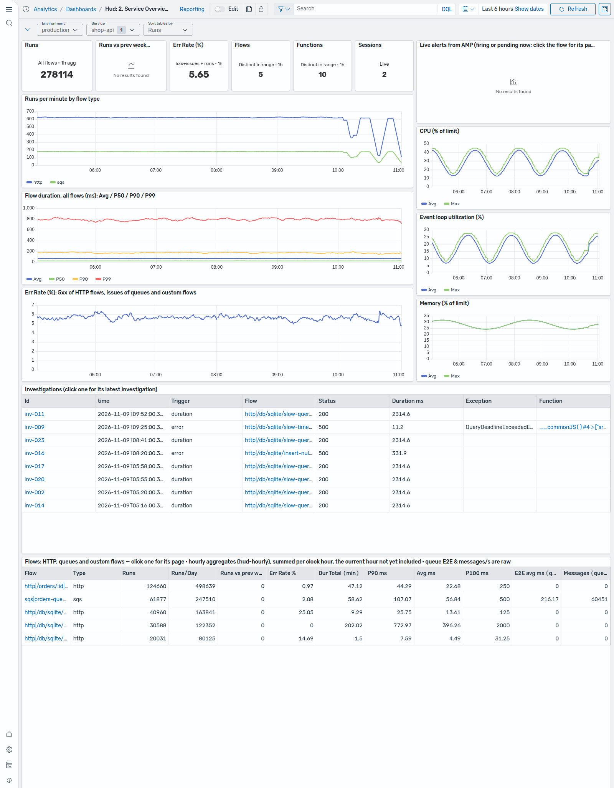
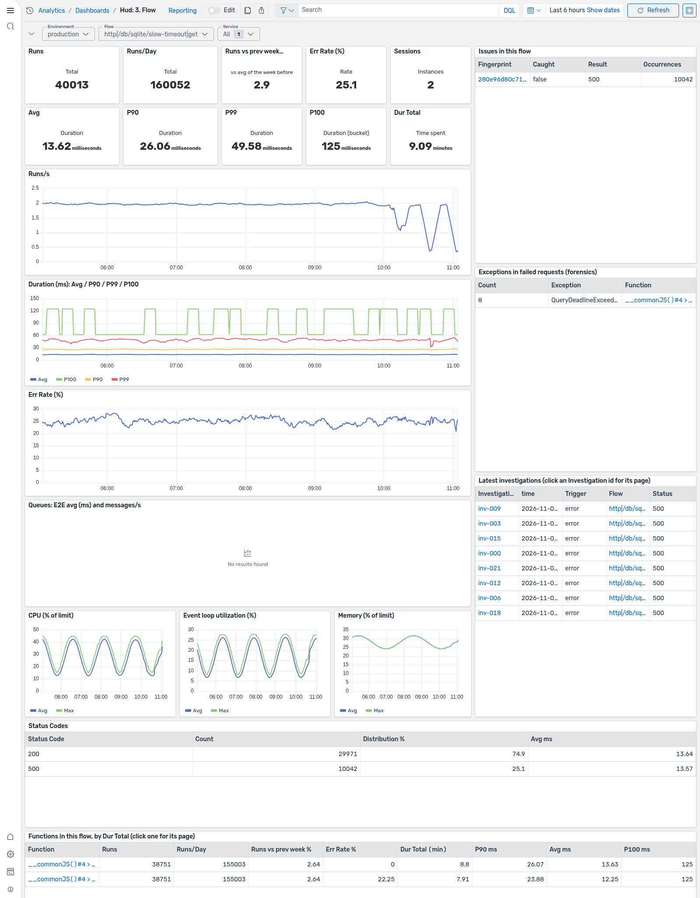
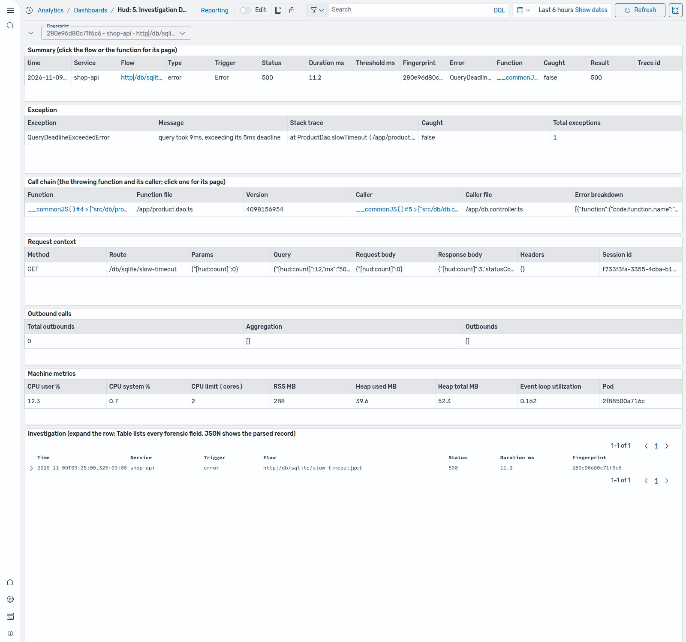

# Hud Integration

## What is Hud?

[Hud](https://hud.io) is a runtime code sensor that reports flow-level and function-level telemetry (runs, durations, errors, exceptions, sessions, process metrics) from production services, and captures a forensic record (an investigation) for each failing or unusually slow request: the exception, the instrumented function that threw it and its caller, the request, the outbound calls and the machine state.

## What is the Hud Integration?

An integration is a bundle of pre-canned assets which are bundled together in a meaningful manner.

The Hud integration includes the following dashboards, generated from the dashboards in [hud-o11y-resources](https://github.com/code-hud/hud-o11y-resources):

- **Hud: 1. Services**: all services in one environment: service count, live sessions, runs and error rate, and a table of the services with runs, runs per day, runs versus the previous week, error rate, P90 and average duration, live sessions, flows and functions invoked, and when each was last seen; plus runs per second by service. Click a service for its overview.
- **Hud: 2. Service Overview**: one service: runs (and versus the previous week), error rate, flow, function and session counts; runs per minute by flow type, flow duration (average, P50, P90, P99), error rate (5xx of HTTP flows, issues of queues and custom flows); the alerts firing now; CPU, event-loop utilization and memory; the latest investigations; tables of the flows (HTTP, queues and custom flows) and of the top 100 functions by total time; and the SDK sessions.
- **Hud: 3. Flow**: one flow (HTTP endpoint, queue or custom flow): runs, runs per day, versus the previous week, error rate, sessions, average / P90 / P99 / P100 and total duration; runs, duration and error rate over time, queue end-to-end duration and messages per second, machine metrics; the issues of the flow, the exceptions in failed requests, the latest investigations, status codes, the functions in the flow by total time, and the full forensic records.
- **Hud: 4. Function**: one function, optionally narrowed to one flow: runs, error rate, average / P90 / P100 and total duration; runs, duration percentiles, errors by type and runs by version (content hash) over time; machine metrics; errors by type; the investigations where it threw or called the thrower; its callers and callees, and the flows it runs in.
- **Hud: 5. Investigation Details**: one investigation: a summary (service, flow, type, trigger, status, duration and threshold, fingerprint, error, function, trace id), the exception with its stack trace, the call chain (the throwing function and its caller), the request context (route, params, query, bodies, headers, session), the outbound calls, the machine metrics at the time, and the full forensic record. Open it from an investigation id, or pick an issue fingerprint to see its latest investigation.

Click a service, a flow or a function in a table to open its page, and an investigation id to open the investigation. The metrics pages have an **Environment** dropdown (default `production`); the overview, flow and function pages also have a **Service** dropdown.







## Requirements

- **OpenSearch Dashboards 3.9 or later, with Explore and dashboard variables enabled, or OpenSearch UI on Amazon OpenSearch Service.** All panels are `explore` saved objects (PromQL or PPL), and every dashboard has variables whose values come from a Prometheus label-values lookup or a PPL query. Dashboard variables were added in 3.7 and the PromQL query type for variables in 3.9. On 3.8 and later, variables are controlled by `dashboard.variables.enabled` (default `true`). The links between dashboards set only the clicked value (the flow, function or investigation), and the target page selects the service that value belongs to, so they work on 3.9. On Amazon OpenSearch Service, the dashboards run in an **Observability workspace** in OpenSearch UI, which is hosted in the AWS Cloud rather than on the domain ([Using OpenSearch UI](https://docs.aws.amazon.com/opensearch-service/latest/developerguide/application.html), [release history](https://docs.aws.amazon.com/opensearch-service/latest/developerguide/application-release-history.html)), so the domain's engine version (3.8 included) doesn't set the floor. Discover Metrics, PromQL panels and dashboard variables are not available in the OpenSearch Dashboards hosted on a domain.
- **A Prometheus direct-query data source named `hud_amp`.** The metrics panels query it with PromQL. Create it before installing, using exactly that name. It can be a self-managed Prometheus (2.40 or later, with native histograms enabled) or an Amazon Managed Service for Prometheus (AMP) workspace; see [Amazon OpenSearch Service and Amazon Managed Service for Prometheus](#amazon-opensearch-service-and-amazon-managed-service-for-prometheus).
- **Native histograms.** `code_flow_duration_seconds`, `code_function_call_duration_seconds` and `hud_flow_e2e_duration_seconds` must be stored as Prometheus native histograms. The panels read them with `histogram_quantile`, `histogram_avg`, `histogram_sum` and `histogram_count` over the bare metric name. AMP supports them.
- **The `hud-hourly` recording rules.** The tables and KPI tiles of **Hud: 1. Services** and **Hud: 2. Service Overview** read hourly aggregates recorded by the `hud-hourly` rule groups instead of scanning raw samples, so they load quickly at any range. The integration can't install Prometheus rules: install them from [hud-o11y-resources](https://github.com/code-hud/hud-o11y-resources/blob/main/deploy/README.md#hourly-recording-rules) before installing the integration, and keep the record names unchanged (`job:code_flow_runs:increase1h`, `flow:code_flow_runs:increase1h`, `function:code_function_calls:increase1h`, `instance:code_flow_runs:increase1h` and the others in [`deploy/aws/hud-hourly-rules.yaml`](https://github.com/code-hud/hud-o11y-resources/blob/main/deploy/aws/hud-hourly-rules.yaml)). That file is an AMP rule namespace in a CloudFormation template; for a self-managed Prometheus, load the rule groups in its `Data` property as a rule file. The aggregates sum one sample per clock hour, so the current hour is not included until it closes, and the panels are empty until the rules have run for an hour.
- **Forensic log records in `logs-otel-v1-*`.** The investigation and exception panels run PPL over the `logs-otel-v1*` index pattern (the integration's `logs_hud` component), so the SDK's `hud.forensic` log records must be indexed there by Data Prepper or OpenSearch Ingestion with the OTel logs layout (`time`, `body`, nested `attributes.*` and `resource.attributes.*`). The panels use the PPL commands `json_extract`, `parse` and `spath`; they were tested with OpenSearch 3.9. Without the records, those panels are empty and the rest of the dashboards work.

The alert rules for these metrics are not part of the integration; see [Install the alert rules](https://github.com/code-hud/hud-o11y-resources/blob/main/opensearch-ui/README.md#install-the-alert-rules) in hud-o11y-resources. The **Live alerts** panel of the Service Overview shows the ones firing or pending.

## Data

### Metrics (Prometheus)

The metric names and labels in this table are the contract the dashboards depend on: the panel queries and dashboard variables use them verbatim. The service is the `job` label, which Prometheus and AMP set from the OTel resource attributes as `[service.namespace/]service.name` on OTLP and remote-write ingestion. `deployment_environment_name` and `service_instance_id` come from the resource attributes `deployment.environment.name` and `service.instance.id`, so the OTLP path into Prometheus must turn those resource attributes into labels (Prometheus `otlp.promote_resource_attributes`, or `resource_to_telemetry_conversion` on the OpenTelemetry Collector `prometheusremotewrite` exporter). The other labels are data-point attributes the Hud SDK sets. The metric names must arrive with the unit suffixes shown.

| Metric | Type | Labels used by the dashboards |
| --- | --- | --- |
| `code_flow_duration_seconds` | native histogram (s) | `job`, `deployment_environment_name`, `service_instance_id`, `code_flow_name`, `code_flow_type`, `http_response_status_code` |
| `code_function_calls_total` | counter | `job`, `deployment_environment_name`, `code_function_name`, `code_function_caller_name`, `code_flow_name`, `hud_function_content_hash` |
| `code_function_errors_total` | counter | as above, plus `error_type` |
| `code_function_call_duration_seconds` | native histogram (s) | as `code_function_calls_total` |
| `hud_flow_issues_total` | counter | `job`, `deployment_environment_name`, `code_flow_name`, `code_flow_type`, `issue_fingerprint`, `hud_issue_caught`, `hud_issue_framework_result` |
| `hud_flow_e2e_duration_seconds` | native histogram (s) | `job`, `deployment_environment_name`, `code_flow_name`, `code_flow_type` (queue flows) |
| `hud_flow_messages_total` | counter | as `hud_flow_e2e_duration_seconds` |
| `process_cpu_utilization_ratio`, `nodejs_eventloop_utilization_ratio` | gauge (0 to 1) | `job`, `deployment_environment_name`, `service_instance_id` |
| `process_memory_usage_bytes`, `hud_process_memory_limit_bytes` | gauge (bytes) | as above |
| `process_uptime_seconds` | gauge (s) | as above; a session is a `service_instance_id` that reports it |

`code_flow_name` names a flow; for an HTTP endpoint it is `http|<route>|<method>`, for example `http|/db/sqlite/slow-query|get`, and `code_flow_type` is `http` for HTTP endpoints and another value for queue consumers and custom flows. `code_function_name` is the function's bundle scope path, for example `__commonJS()#11 > ["build/tsc/src/db/product.dao.js"] > spinQuery`. Function series carry the `code_flow_name` of the flow they ran in, which is how the flow page lists the functions of a flow. There is no request counter: runs are `histogram_count(code_flow_duration_seconds)`.

The `hud-hourly` rules record, per hour and per `deployment_environment_name` and `job`, the runs, errors and durations of each service (`job:…`), flow (`flow:…`), function (`function:…`) and instance (`instance:…`). The names end in `:increase1h` (and `instance:process_uptime_seconds:last_timestamp`).

The SDK exports delta temporality, so an OpenTelemetry Collector in front of Prometheus remote write needs the `deltatocumulative` processor.

### Forensic logs (OpenSearch)

Each forensic is one OTLP log record of severity `ERROR` with the event name `hud.forensic`. Because the event name itself is not indexed by every pipeline, the panels recognize a forensic by `attributes.hud.forensic.type`, which is `error` (a request that failed) or `duration` (a request slower than its threshold). The investigation id is the record's document `_id`. The fields in this table are the contract (Hud SDK 1.12 names); [`schemas/logs_hud-1.0.0.mapping.json`](../schemas/logs_hud-1.0.0.mapping.json) maps them, and [`data/sample.json`](../data/sample.json) has three records (an uncaught error, a caught error and a slow request).

| Field | Used for |
| --- | --- |
| `time` | the index pattern's time field |
| `resource.attributes.service.name` | the service; matched against the `job` label of the metrics |
| `resource.attributes.deployment.environment.name` | the environment; matched against the `deployment_environment_name` label |
| `attributes.hud.forensic.type` | `error` or `duration`; identifies a forensic record |
| `attributes.code.flow.name` | the flow, the same value as the `code_flow_name` metric label |
| `attributes.http.route`, `attributes.http.request.method`, `attributes.http.response.status_code` | the request and its status |
| `attributes.issue.fingerprint` | the issue (error forensics only); joins the `hud_flow_issues_total` metric's `issue_fingerprint` label |
| `attributes.hud.issue.caught`, `attributes.hud.issue.framework_result` | whether the framework caught the error, and what it answered |
| `attributes.hud.issue.sources` | the instrumented functions that threw, each as `<error type>@<file>:<code.function.name>`; empty when no instrumented function threw (a caught error), in which case the panels fall back to the body |
| `attributes.hud.parent.service.name`, `attributes.hud.parent.flow.name`, `attributes.hud.root.service.name`, `attributes.hud.root.flow.name` | on a downstream request, the calling service and flow and the service and flow where the request started; mapped for queries, not read by the panels |
| `body` | the forensic as a JSON string: `triggerType`, `duration` (ns), `durationThreshold` (ns), `exceptions[]` (`name`, `message`, `stackTrace`, `executionFlow[].function` and `.caller` with their `code.function.name`, `code.file.path` and `hud.function.content_hash`), `context` (`route`, `method`, `params`, `query`, `request_body`, `response_body`, `extra_headers`, `session_id`, `machine_metrics`, `system_info`), `outbounds[]`, `outboundAggregation`, `errorBreakdown` |
| `traceId` | the OTel trace id of the request, when the service propagates one |

The SDK sends the log records over OTLP alongside the metrics; a Data Prepper `otel_logs_source` pipeline (or an OpenSearch Ingestion pipeline from the OTel logs blueprint) writing to `logs-otel-v1-%{yyyy.MM.dd}` with `output_format: otel` indexes them in this shape. Data Prepper's flattened `opensearch` output format (`log.attributes.hud@forensic@type`, `serviceName`) is not supported by this integration; for that layout, use the dashboard loader in hud-o11y-resources instead.

## Installation

Install the integration from **Integrations** in OpenSearch Dashboards. When asked for the data source, enter `logs-otel-v1*`: it is the index pattern the investigation panels read.

The links between dashboards (clicking a service, a flow, a function or an investigation in a table) open dashboards by id. Installing from **Integrations** gives every saved object a new id. Each panel that links to a dashboard declares the target in its `references` as a reference of type `dashboard` whose name starts with `link_`, such as `link_endpoint_dashboard` or `link_function_dashboard`, and the integrations installer rewrites the ids of declared targets inside the panel's links to the new ids. This needs the installer fix in [dashboards-observability#1](https://github.com/code-hud/dashboards-observability/pull/1); with an installer that lacks it, the links show "Could not locate that dashboard" after an install from **Integrations**, so import the assets manually instead.

To import the assets manually, import `assets/hud-1.0.0.ndjson` via **Dashboards Management > Saved objects > Import**. It holds all the dashboards, their panels and the index pattern. Manual import keeps the saved object ids, so the links between dashboards work. In an OpenSearch UI workspace, import from **Assets > Import** and choose **Check for existing assets**: the default, **Create new assets with unique IDs**, gives the objects new ids and breaks the links. Importing through the saved objects API with a `dataSourceId` parameter also renames every object to `<dataSourceId>_<id>`, which breaks the links in the same way.

**Try with sample data** loads only the sample investigation log records into an `ss4o_logs_hud-*-sample` index; the metric dashboards need a live Prometheus source. The investigation panels' PPL reads `source = logs-otel-v1*,ss4o_logs_hud-*-sample`, so they show the sample records (they keep their capture dates, so widen the time range if they're older than its default); where no sample index exists, the second pattern matches nothing and the results are unchanged.

The saved object ids are the same as in hud-o11y-resources (`hud-services-dashboard`, `hud-logs-otel-v1`, and so on), so a manual import over dashboards imported from there replaces them.

## Amazon OpenSearch Service and Amazon Managed Service for Prometheus

On AWS, metrics go to an Amazon Managed Service for Prometheus (AMP) workspace, forensic logs go to an OpenSearch Service domain through an OpenSearch Ingestion pipeline (the OTel logs blueprint, writing to `logs-otel-v1-%{yyyy.MM.dd}`), and the dashboards run in an OpenSearch UI Observability workspace.

1. **Send metrics to AMP as native histograms.** Use an OpenTelemetry Collector (or the AWS Distro for OpenTelemetry) with the `prometheusremotewrite` exporter and the `sigv4auth` extension, pointed at `https://aps-workspaces.<region>.amazonaws.com/workspaces/<workspace-id>/api/v1/remote_write`. That exporter writes OTel exponential histograms as native histograms, and AMP stores and queries them with no workspace setting. Enable `resource_to_telemetry_conversion` so `deployment_environment_name` and `service_instance_id` become labels. The collector's credentials need `aps:RemoteWrite`. Don't route the metrics through the OpenSearch Ingestion `prometheus` sink: it writes histograms as separate `_bucket`, `_sum` and `_count` series, which these panels can't read.

   ```yaml
   extensions:
     sigv4auth:
       region: <region>
       service: aps
   exporters:
     prometheusremotewrite:
       endpoint: https://aps-workspaces.<region>.amazonaws.com/workspaces/<workspace-id>/api/v1/remote_write
       auth:
         authenticator: sigv4auth
       resource_to_telemetry_conversion:
         enabled: true
   service:
     extensions: [sigv4auth]
     pipelines:
       metrics:
         receivers: [otlp]
         exporters: [prometheusremotewrite]
   ```

2. **Install the `hud-hourly` recording rules** in the AMP workspace, as the `hud-hourly` rule namespace; see [Hourly recording rules](https://github.com/code-hud/hud-o11y-resources/blob/main/deploy/README.md#hourly-recording-rules).

3. **Connect AMP as the `hud_amp` data source.** In the OpenSearch Service console, open **Central management > Connected data sources > Connect new data source**, choose **Amazon Managed Service for Prometheus**, and name it `hud_amp`. OpenSearch Service queries AMP with an IAM role that it assumes, and signs the requests with SigV4 itself, so no credentials are stored in OpenSearch. Let the console create the role, or pass your own:

   ```
   aws opensearch add-direct-query-data-source \
     --data-source-name hud_amp \
     --data-source-type 'Prometheus={RoleArn=arn:aws:iam::<account>:role/<role>,WorkspaceArn=arn:aws:aps:<region>:<account>:workspace/<workspace-id>}'
   ```

   The role's trust policy must allow `directquery.opensearchservice.amazonaws.com` to call `sts:AssumeRole`, scoped with `aws:SourceArn` = `arn:aws:opensearch:<region>:<account>:datasource/hud_amp` and `aws:SourceAccount`. For these dashboards the role needs `aps:QueryMetrics`, `aps:GetLabels`, `aps:GetSeries` and `aps:GetMetricMetadata` on the workspace. The OpenSearch Service documentation lists the full policy, which adds the alerting and rule-group actions that OpenSearch UI's alerting pages use.

4. **Use an Observability workspace.** AMP data sources are only available in Observability workspaces of OpenSearch UI. Associate both the `hud_amp` data connection and the OpenSearch domain that holds `logs-otel-v1-*` with the workspace, then import the assets there as described in [Installation](#installation).

Limits that apply on AMP: a query times out after 30 seconds, and each query counts against the workspace's Query Samples Processed quota. The hourly-aggregate panels work at ranges up to 31 days, and the "vs previous week" comparisons up to 24 days; see [Known limitations](https://github.com/code-hud/hud-o11y-resources/blob/main/opensearch-ui/README.md#known-limitations) in hud-o11y-resources.
