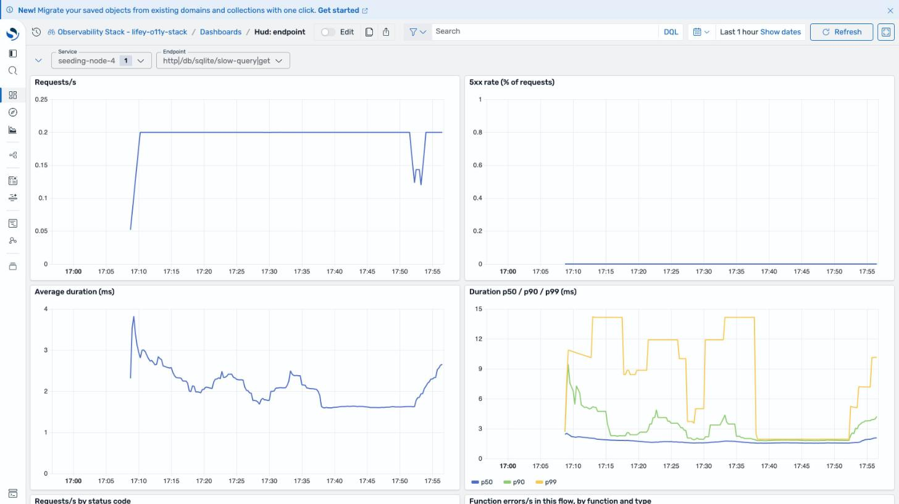
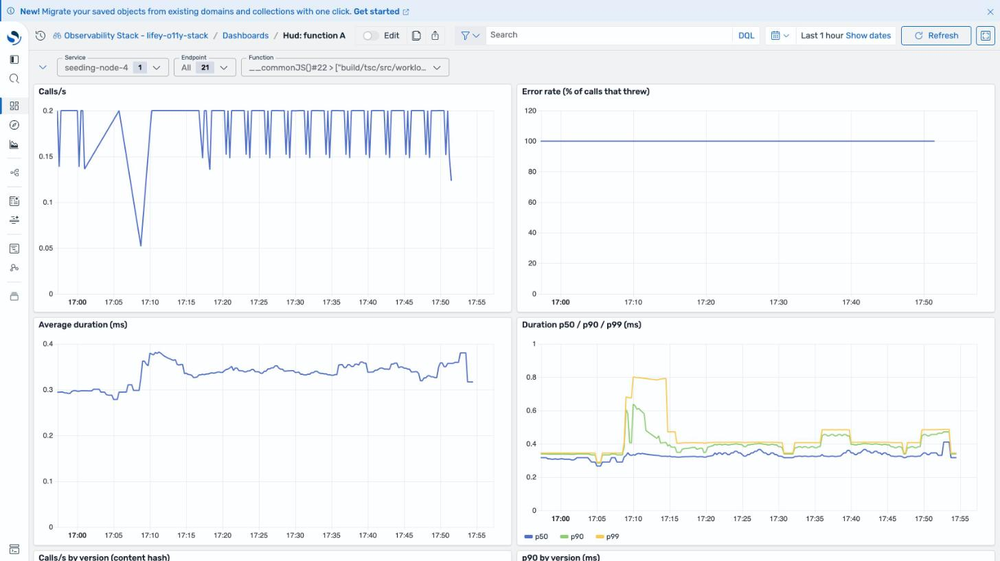

# Hud Integration

## What is Hud?

[Hud](https://hud.io) is a runtime code sensor that reports function-level and endpoint-level telemetry (invocations, durations, errors, exceptions) from production services, and captures forensics for failing requests ("investigations").

## What is the Hud Integration?

An integration is a bundle of pre-canned assets which are bundled together in a meaningful manner.

The Hud integration includes the following dashboards:

- **Hud: service overview**: one service's requests, 5xx rate, endpoint latency (average and p50 / p90 / p99, overall and per endpoint), flow and function counts, a table of all endpoints, function call rate, function errors by type, p90 by function version, and a table of all functions.
- **Hud: endpoint**: one endpoint (flow) in one or all services: request rate, 5xx rate, duration percentiles, requests by status code, function errors in the flow, and the functions called in the flow.
- **Hud: function**: one function in one or all services and one or all endpoints: call rate, error rate, duration percentiles, calls and p90 by version, errors by type, callers, and callees with their share of its time.

Click an endpoint or a function in a table to open its page. Each page has dropdowns for the service and, on the function page, the endpoint; the detail pages offer **All** for them.






## Requirements

- **OpenSearch Dashboards 3.10 or later, with Explore and dashboard variables enabled, or OpenSearch UI on Amazon OpenSearch Service.** All panels are `explore` saved objects (PromQL), and every dashboard has variables (service, endpoint, function) whose values come from a Prometheus label-values lookup. Dashboard variables were added in 3.7, the PromQL query type for variables was added in 3.9, and links between dashboards set variables to `$__all`, which is supported from 3.10 ([OpenSearch-Dashboards#12970](https://github.com/opensearch-project/OpenSearch-Dashboards/pull/12970)); on 3.9 the linked dashboards show no data. On 3.8 and later, variables are controlled by `dashboard.variables.enabled` (default `true`). On Amazon OpenSearch Service, use an **Observability workspace** in OpenSearch UI: Discover Metrics, PromQL panels and dashboard variables are not available in the OpenSearch Dashboards hosted on a domain.
- **A Prometheus direct-query data source named `hud_prometheus`.** The service, endpoint and function panels query it with PromQL. Create it before installing, using exactly that name. It can be a self-managed Prometheus (2.40 or later, with native histograms enabled) or an Amazon Managed Service for Prometheus (AMP) workspace; see [Amazon OpenSearch Service and Amazon Managed Service for Prometheus](#amazon-opensearch-service-and-amazon-managed-service-for-prometheus).
- **Native histograms.** `code_function_call_duration_seconds` and `code_flow_duration_seconds` must be stored as Prometheus native histograms. The panels read them with `histogram_quantile`, `histogram_avg`, `histogram_sum` and `histogram_count` over the bare metric name, and use the `@ end()` modifier. AMP supports both.
- **Investigation logs** are not yet exported by the Hud SDK in OTLP mode, so no panel reads `logs-otel-v1-*` today. The integration keeps the `logs-otel-v1*` index pattern (its `logs_hud` component) for the investigation panels that will follow.

## Data

### Metrics (Prometheus)

The metric names and labels in this table are the contract the dashboards depend on: the panel queries and dashboard variables use them verbatim. `service_name` and `service_instance_id` come from the OTel resource attributes `service.name` and `service.instance.id`, so the OTLP path into Prometheus must turn resource attributes into labels (Prometheus `otlp.promote_resource_attributes`, or `resource_to_telemetry_conversion` on the OpenTelemetry Collector `prometheusremotewrite` exporter). The other labels are data-point attributes the Hud SDK sets. The metric names must arrive without a unit suffix.

| Metric | Type | Labels used by the dashboards |
| --- | --- | --- |
| `code_function_calls_total` | counter | `service_name`, `service_instance_id`, `code_function_name`, `hud_function_short_name`, `code_file_path`, `code_function_caller_name`, `code_flow_name`, `hud_function_content_hash` |
| `code_function_errors_total` | counter | as above, plus `error_type` |
| `code_function_call_duration_seconds` | native histogram (s) | as `code_function_calls_total` |
| `code_flow_duration_seconds` | native histogram (s) | `service_name`, `code_flow_name`, `http_route`, `http_request_method`, `http_response_status_code` |

`code_function_name` is the function's bundle scope path, for example `__commonJS()#11 > ["build/tsc/src/db/product.dao.js"] > spinQuery`; `hud_function_short_name` and `code_file_path` are its display name and source-mapped file. `code_flow_name` names an endpoint as `http|<route>|<method>`, for example `http|/db/sqlite/slow-query|get`. There is no request counter: requests are `histogram_count(code_flow_duration_seconds)`. Function series carry the `code_flow_name` of the flow they ran in, which is how the endpoint page lists the functions of a flow; functions called outside any flow have no `code_flow_name`.

The SDK exports delta temporality, so an OpenTelemetry Collector in front of Prometheus remote write needs the `deltatocumulative` processor.

### Investigation logs (OpenSearch)

Not exported yet by the SDK in OTLP mode. When they are, each investigation will be one log record with `attributes.event.name = 'hud.investigation'`; the planned fields are described by [`schemas/logs_hud-1.0.0.mapping.json`](../schemas/logs_hud-1.0.0.mapping.json), and [`data/sample.json`](../data/sample.json) has example records.

## Installation

Install the integration from **Integrations** in OpenSearch Dashboards. When asked for the data source, enter `logs-otel-v1*`.

The links between dashboards (clicking an endpoint or a function in a table) open dashboards by id. Installing from **Integrations** gives every saved object a new id. Each panel that links to a dashboard declares the target in its `references` as a reference of type `dashboard` whose name starts with `link_`, such as `link_endpoint_dashboard` or `link_function_dashboard`, and the integrations installer rewrites the ids of declared targets inside the panel's links to the new ids. This needs the installer fix in [dashboards-observability#1](https://github.com/code-hud/dashboards-observability/pull/1); with an installer that lacks it, the links show "Could not locate that dashboard" after an install from **Integrations**, so import the assets manually instead.

To import the assets manually, import `assets/hud-shared-1.0.0.ndjson` first, then the dashboard bundles, via **Dashboards Management > Saved objects > Import**. The shared bundle holds the index pattern. Manual import keeps the saved object ids, so the links between dashboards work. In an OpenSearch UI workspace, import from **Assets > Import** and choose **Check for existing assets**: the default, **Create new assets with unique IDs**, gives the objects new ids and breaks the links. Importing through the saved objects API with a `dataSourceId` parameter also renames every object to `<dataSourceId>_<id>`, which breaks the links in the same way.

## Amazon OpenSearch Service and Amazon Managed Service for Prometheus

On AWS, metrics go to an Amazon Managed Service for Prometheus (AMP) workspace, investigation logs go to an OpenSearch Service domain, and the dashboards run in an OpenSearch UI Observability workspace.

1. **Send metrics to AMP as native histograms.** Use an OpenTelemetry Collector (or the AWS Distro for OpenTelemetry) with the `prometheusremotewrite` exporter and the `sigv4auth` extension, pointed at `https://aps-workspaces.<region>.amazonaws.com/workspaces/<workspace-id>/api/v1/remote_write`. That exporter writes OTel exponential histograms as native histograms, and AMP stores and queries them with no workspace setting. Enable `resource_to_telemetry_conversion` so `service_name` becomes a label. The collector's credentials need `aps:RemoteWrite`. Don't route the metrics through the OpenSearch Ingestion `prometheus` sink: it writes histograms as separate `_bucket`, `_sum` and `_count` series, which these panels can't read.

   ```yaml
   extensions:
     sigv4auth:
       region: <region>
       service: aps
   exporters:
     prometheusremotewrite:
       endpoint: https://aps-workspaces.<region>.amazonaws.com/workspaces/<workspace-id>/api/v1/remote_write
       auth:
         authenticator: sigv4auth
       resource_to_telemetry_conversion:
         enabled: true
   service:
     extensions: [sigv4auth]
     pipelines:
       metrics:
         receivers: [otlp]
         exporters: [prometheusremotewrite]
   ```

2. **Connect AMP as the `hud_prometheus` data source.** In the OpenSearch Service console, open **Central management > Connected data sources > Connect new data source**, choose **Amazon Managed Service for Prometheus**, and name it `hud_prometheus`. OpenSearch Service queries AMP with an IAM role that it assumes, and signs the requests with SigV4 itself, so no credentials are stored in OpenSearch. Let the console create the role, or pass your own:

   ```
   aws opensearch add-direct-query-data-source \
     --data-source-name hud_prometheus \
     --data-source-type 'Prometheus={RoleArn=arn:aws:iam::<account>:role/<role>,WorkspaceArn=arn:aws:aps:<region>:<account>:workspace/<workspace-id>}'
   ```

   The role's trust policy must allow `directquery.opensearchservice.amazonaws.com` to call `sts:AssumeRole`, scoped with `aws:SourceArn` = `arn:aws:opensearch:<region>:<account>:datasource/hud_prometheus` and `aws:SourceAccount`. For these dashboards the role needs `aps:QueryMetrics`, `aps:GetLabels`, `aps:GetSeries` and `aps:GetMetricMetadata` on the workspace. The OpenSearch Service documentation lists the full policy, which adds the alerting and rule-group actions that OpenSearch UI's alerting pages use.

3. **Use an Observability workspace.** AMP data sources are only available in Observability workspaces of OpenSearch UI. Associate both the `hud_prometheus` data connection and the OpenSearch domain that holds `logs-otel-v1-*` with the workspace, then import the assets there as described in [Installation](#installation).

Limits that apply on AMP: a query times out after 30 seconds, and each query counts against the workspace's Query Samples Processed quota. Panels that aggregate over the whole time range (`[$__range] @ end()`) read more samples the longer the range, so keep dashboard ranges to hours or a few days.
